<p align="center">
  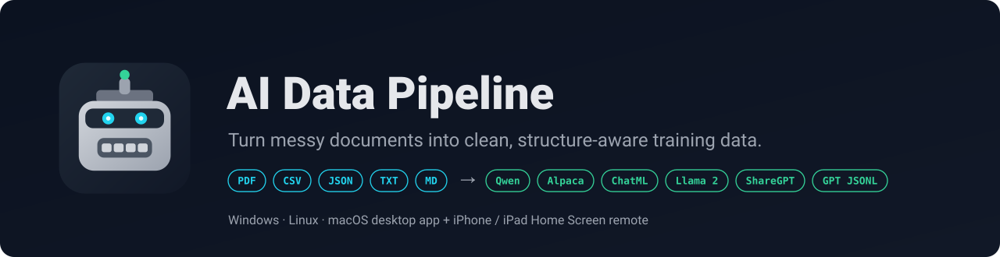
</p>

<p align="center">
  
  
  
  
</p>

# AI Data Pipeline

**A desktop application that turns raw documents (PDF, CSV, JSON, JSONL, TXT, Markdown) into clean, validated, model-specific training data for large language models.**

You point it at a folder of messy files. It sanitizes them, splits them into sensible chunks, optionally rewrites them in a chosen voice, formats them for your target model (ChatGPT, Qwen, Llama, Alpaca, ChatML and more), and scores the result. Every step writes to its own folder, so you can inspect, stop, or re-run any stage.

PDFs get special treatment. Rather than flattening a PDF into one blob and slicing it every N characters, the pipeline reads the page layout, removes repeated headers and footers, rebuilds the section tree, and chunks **inside** sections, so each chunk is a complete thought that carries its own `Document > Section > Subsection` breadcrumb.

---

## Table of contents

1. [What it does](#what-it-does)
2. [The four-phase pipeline](#the-four-phase-pipeline)
3. [Quick start](#quick-start)
4. [Installation](#installation) (Linux/macOS, Windows, iPhone/iPad)
5. [A tour of the desktop app](#a-tour-of-the-desktop-app)
6. [Structure-aware PDF processing](#structure-aware-pdf-processing)
7. [Output formats](#output-formats)
8. [Security and sanitization](#security-and-sanitization)
9. [Personalities](#personalities)
10. [AI providers and cost control](#ai-providers-and-cost-control)
11. [The Ten Pillars quality system](#the-ten-pillars-quality-system)
12. [Command-line reference](#command-line-reference)
13. [Configuration reference](#configuration-reference)
14. [iPhone / iPad remote](#iphone--ipad-remote)
15. [Project layout and architecture](#project-layout-and-architecture)
16. [Testing](#testing)
17. [Troubleshooting](#troubleshooting)
18. [Known limitations](#known-limitations)
19. [More documentation](#more-documentation)
20. [License](#license)

---

## What it does

| You want to... | How the pipeline helps |
|----------------|------------------------|
| **Fine-tune ChatGPT** | Writes OpenAI chat-format JSONL (`{"messages": [...]}`), plus a combined `chatgpt_training.jsonl` |
| **Train open models** (Llama, Qwen, Mistral, Zephyr...) | Ten conversation formats, selectable per run |
| **Give training data a consistent voice** | Personality templates with an adjustable strength, plus custom personalities |
| **Clean untrusted documents** | Unicode normalization, invisible-character and bidirectional-override removal, homoglyph and entropy checks, quarantine of suspicious files |
| **Prepare data for RAG / retrieval** | Self-contained, section-aware chunks with page ranges, source-block IDs and quality flags, ready to embed |
| **Keep costs near zero** | Runs end to end against local models (Ollama, LM Studio) with a $0 daily limit |
| **Operate it from your phone** | A Home Screen web app that uploads files, starts runs and streams the log |

**Inputs:** `.pdf` `.csv` `.json` `.jsonl` `.txt` `.md`  **Outputs:** training JSONL/text in any of 10 formats, plus validation reports and audit trails.

---

## The four-phase pipeline

<p align="center">
  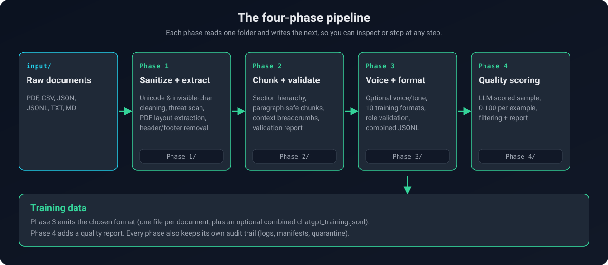
</p>

Each phase reads one folder and writes the next. The folder chain is configurable (**Folders** tab); the defaults are:

```
input/  ->  Phase 1/  ->  Phase 2/  ->  Phase 3/  ->  Phase 4/
```

| Phase | Name | What happens | Output folder |
|-------|------|--------------|---------------|
| **1** | Input parsing and sanitization | Parses each file, normalizes Unicode, removes invisible characters, runs the threat scan. For PDFs it also extracts layout structure and removes page furniture (saves `<name>_structure.json` and `<name>_furniture_audit.json`) | `Phase 1/` |
| **2** | Chunking and fact extraction | Builds the section hierarchy, chunks within sections at paragraph/sentence boundaries, adds context prefixes, and validates every chunk | `Phase 2/` |
| **3** | Personality prompting and formatting | Optional tone/personality transformation, then formats each example for the chosen target model | `Phase 3/` |
| **4** | Quality scoring and assessment | LLM-scored sample, filtering and a report | `Phase 4/` |

**Each phase is a toggle** ("red light / green light"). Turn Phase 3 off and the pipeline stops after chunking; turn Phase 4 off to skip scoring and its API cost. Toggle state lives in `config/pipeline_phases.json`.

---

## Quick start

```bash
# 1. Install (Linux/macOS)
cd backup_cleanup/python_files
python3 setup.py --install-type full --yes

# 2. Check the install is healthy (no API key needed)
./run_pipeline.sh --health-only --smoke

# 3. Launch the app
./go_live.sh
```

Then in the app:

1. **Main Control** -> **Browse** to your folder of documents -> **Scan Files**
2. **Processing** -> pick an output format (use **GPT JSONL** for ChatGPT fine-tuning)
3. **AI Settings** -> pick a provider (choose **Ollama** or **LM Studio** to stay free)
4. **Phase Control** -> confirm which phases are green
5. **Main Control** -> **START PIPELINE**

No GUI? Run headless: `python pipeline_cli.py process --folder input` (see [Command-line reference](#command-line-reference)).

---

## Installation

### Requirements

- Python **3.10+** with Tk (`python3-tk` on Debian/Ubuntu; included in the Windows and macOS installers from python.org)
- 4 GB RAM minimum, 8 GB recommended
- For structure-aware PDF processing: `pymupdf` and `tiktoken` (installed automatically). `pdfplumber` and `PyPDF2` serve as fallbacks.
- Optional: `pytesseract` plus the Tesseract binary for scanned PDFs
- Optional: an OpenAI or OpenRouter key. Not needed for local models.

### Linux / macOS

```bash
cd backup_cleanup/python_files
python3 setup.py --install-type full --yes
```

This creates a virtual environment, installs the dependencies, and (on Linux) creates a desktop launcher and app-menu shortcut. To (re)create launchers on their own:

```bash
python3 install_app.py              # desktop + app menu launchers
python3 install_app.py --only ios   # just the iPhone/iPad remote setup
```

Launch any time with the desktop icon, `~/.local/bin/ai-data-pipeline-launcher`, or `./go_live.sh`.

### Windows

1. Install [Python 3.10+](https://www.python.org/downloads/) (tick **Add python.exe to PATH** and keep **tcl/tk** selected; or `winget install Python.Python.3.12`).
2. Double-click **`Install-Windows.bat`** in the repository root.

The installer (`backup_cleanup/python_files/install_windows.ps1`) finds Python, creates a virtual environment next to the code, installs the dependencies, and adds an **AI Data Pipeline** icon to your Desktop and Start Menu. Nothing is installed system-wide and your PowerShell execution policy is not changed.

```powershell
# from backup_cleanup\python_files
powershell -ExecutionPolicy Bypass -File install_windows.ps1 -Minimal     # skip the PDF-structure dependencies
powershell -ExecutionPolicy Bypass -File install_windows.ps1 -NoDesktop   # Start Menu shortcut only
powershell -ExecutionPolicy Bypass -File install_windows.ps1 -DryRun      # show the plan, change nothing
powershell -ExecutionPolicy Bypass -File install_windows.ps1 -Uninstall   # remove shortcuts (-RemoveVenv for the venv too)
```

> **Tested vs. untested:** the installer logic is covered by automated tests that run on Linux (including a dry run under PowerShell). It has **not** been run on a physical Windows machine.

### iPhone / iPad

iOS cannot run the desktop app, so the "iOS installer" sets up a **remote control**: a Home Screen web app that drives the computer running the pipeline. See [iPhone / iPad remote](#iphone--ipad-remote).

---

## A tour of the desktop app

The app (`unified_pipeline_gui.py`, Tkinter) has nine tabs. The screenshots below are the real application.

### Main Control

<p align="center">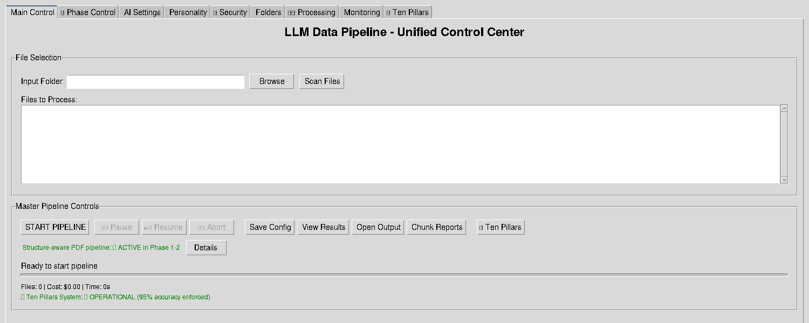</p>

The command center. Pick the input folder, scan for files, then start, pause, resume or abort a run.

| Control | Description |
|---------|-------------|
| **Input Folder / Browse / Scan Files** | Choose a folder and list the supported files found in it |
| **START PIPELINE** | Runs the enabled phases over the listed files |
| **Pause / Resume / Abort** | Control a running job |
| **Save Config** | Persist current settings |
| **View Results / Open Output** | Open the output folders |
| **Chunk Reports** | Opens a summary of every Phase 2 validation report: chunk counts, flagged chunks, missing numbered units, and the exact issues |
| **Structure-aware status line / Details** | Real import and dependency checks showing whether the structure-aware PDF pipeline is active or degraded (see below) |
| **Status line** | Files processed, cost so far, elapsed time |

### Phase Control

<p align="center">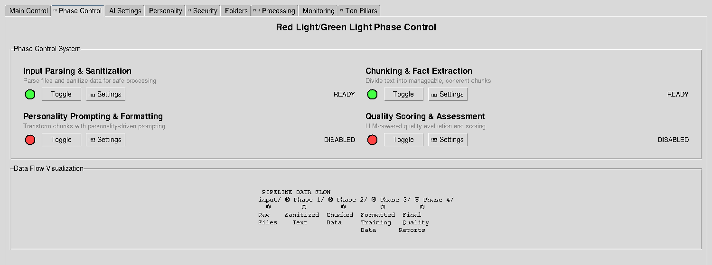</p>

Red light / green light control for each phase. **Toggle** enables or disables a phase; **Settings** opens that phase's options. A data-flow diagram shows the folder chain.

**Phase 2 settings** are the structure-aware chunker's controls: **Target tokens** (default 500) and **Max tokens** (hard ceiling including the context prefix, default 800). If Target is larger than Max it is lowered to Max.

<p align="center">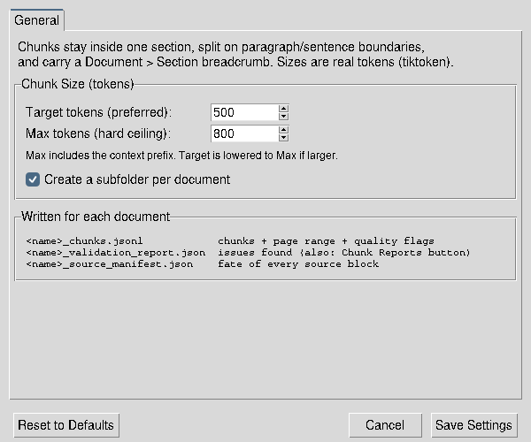</p>

> **Upgrading note:** older versions of the app saved `max_chunk_tokens = 150` (no `target_tokens`). Applied to the structure-aware chunker that would have capped every chunk at 150 tokens, so the app now migrates that legacy setting to 500/800 when it loads the config. Values you chose yourself are kept.

### AI Settings

<p align="center">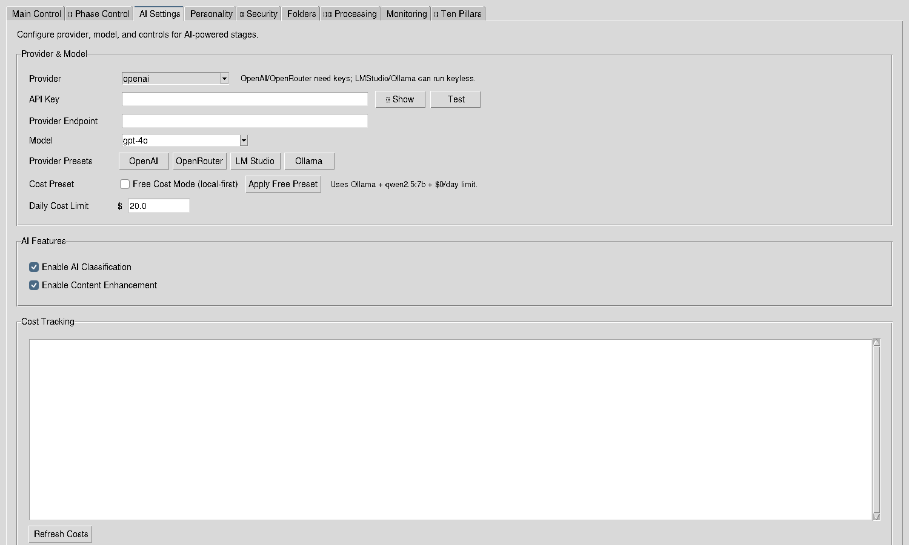</p>

| Setting | Description |
|---------|-------------|
| **Provider** | OpenAI, OpenRouter, LM Studio or Ollama |
| **API Key / Show / Test** | Key entry (masked by default) and a connection test |
| **Provider Endpoint** | Custom base URL, auto-filled per provider |
| **Model** | e.g. `gpt-4o`, `qwen2.5:7b`, `llama3.1:8b` |
| **Provider Presets** | One-click OpenAI / OpenRouter / LM Studio / Ollama setup |
| **Free Cost Mode** | Applies the Ollama + `qwen2.5:7b` preset with a $0/day limit |
| **Daily Cost Limit** | Hard budget for the day |
| **AI Classification / Content Enhancement** | Toggle the AI-powered stages |
| **Cost Tracking** | Per-call spend log with **Refresh Costs** |

### Personality

<p align="center">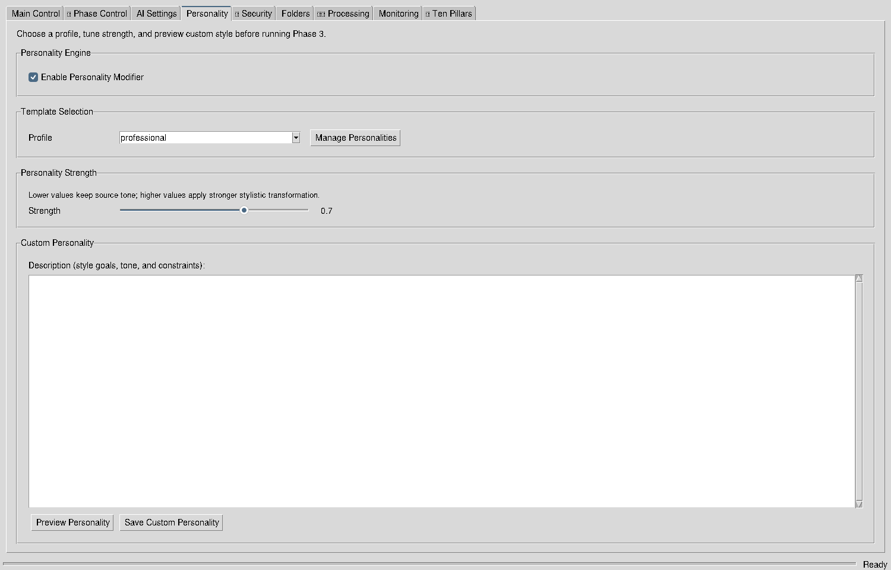</p>

Choose a profile, set its **Strength** (0.1 subtle to 1.0 strong), or write a custom personality and **Preview** it before running Phase 3. Details in [Personalities](#personalities).

### Security

<p align="center">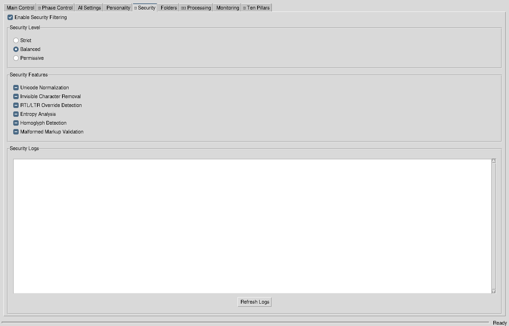</p>

Pick a security level (Strict / Balanced / Permissive) and toggle individual checks. The log pane shows what was detected and what action was taken. Details in [Security and sanitization](#security-and-sanitization).

### Structure-aware pipeline status

The line under the Main Control buttons says whether the structure-aware PDF pipeline is **active**, **degraded** (PyMuPDF or tiktoken missing) or **unavailable** (a module is missing, so Phase 2 uses the basic sentence chunker). **Details** lists each component and dependency as `OK`, `MISSING` or `absent`, with the current chunk-size settings. This is a live check, not a fixed label.

<p align="center">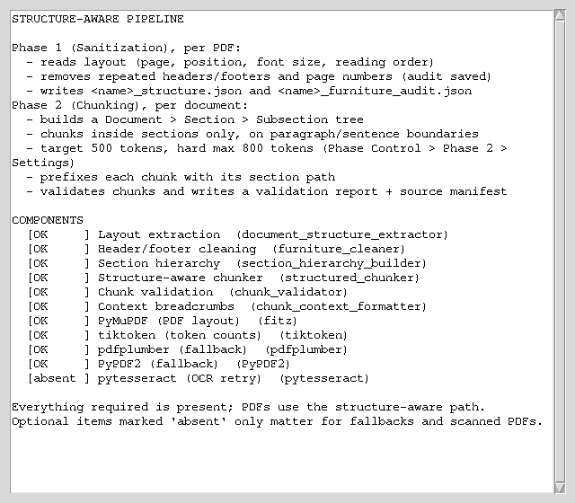</p>

### Processing

<p align="center">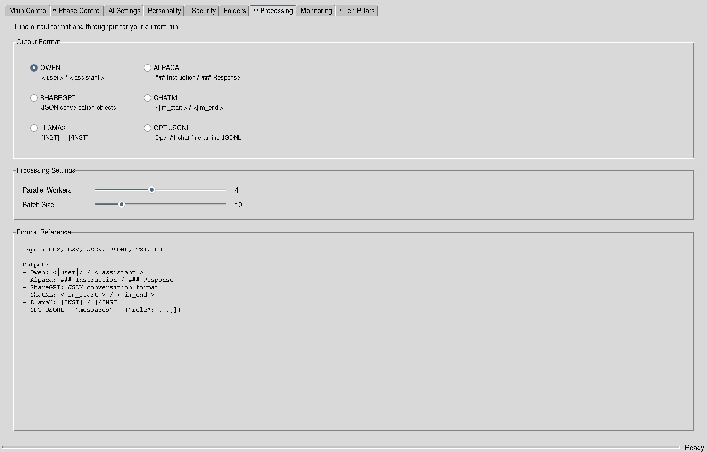</p>

Choose the output format, **Parallel Workers** (1-8, default 4) and **Batch Size** (1-50, default 10). Lower the worker count if you run out of memory.

The Processing tab offers all ten formats. Choosing one also sets Phase 3's **Target AI family**, because Phase 3 renders by that target (earlier builds let the target, default `qwen`, silently override this tab). Choosing a target in the Phase 3 settings updates this tab in return. See [Output formats](#output-formats).

### Folders, Monitoring and Ten Pillars

- **Folders**: set the input folder and each phase's output folder, with live file counts and sizes (**Refresh Status**, **Open Folder**, **Clean Folder**).
- **Monitoring**: real-time logs, per-phase results, system status (memory/CPU) and statistics.
- **Ten Pillars**: status and details for the [data-quality system](#the-ten-pillars-quality-system). Per-metric scores read "not measured" until items have actually been scored.

<p align="center">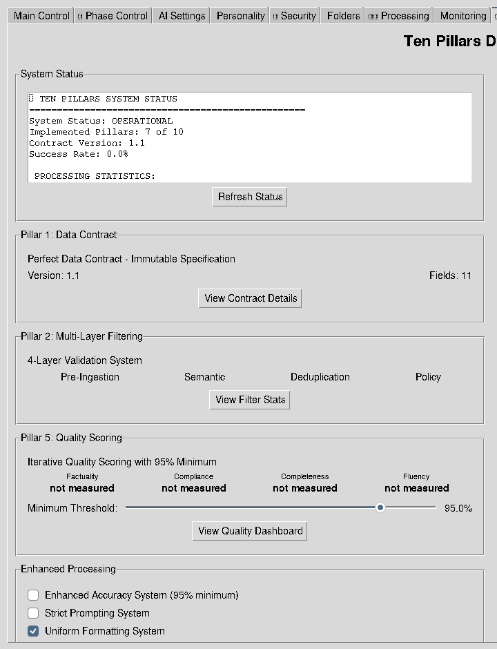</p>

---

## Structure-aware PDF processing

Naive PDF chunking fails in predictable ways: running headers and page numbers end up inside chunks, a list of four tips gets cut in half, and a chunk retrieved on its own has no idea which chapter it came from.

<p align="center">
  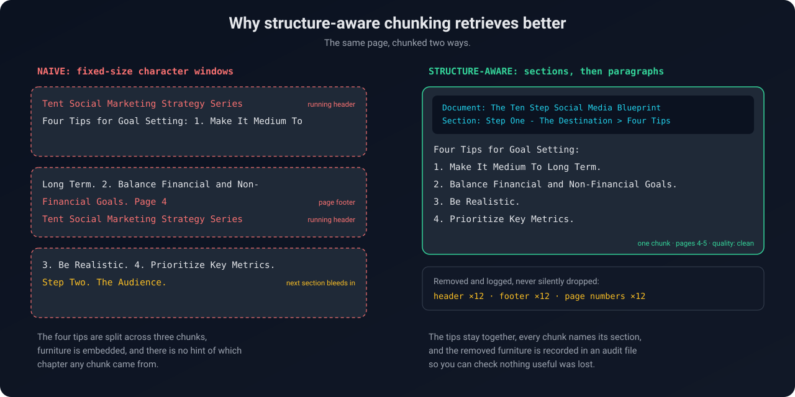
</p>

> The figure is an **illustration** of the failure modes the pipeline targets, not output from a specific real document.

The structure-aware pipeline fixes each of these with seven stages:

<p align="center">
  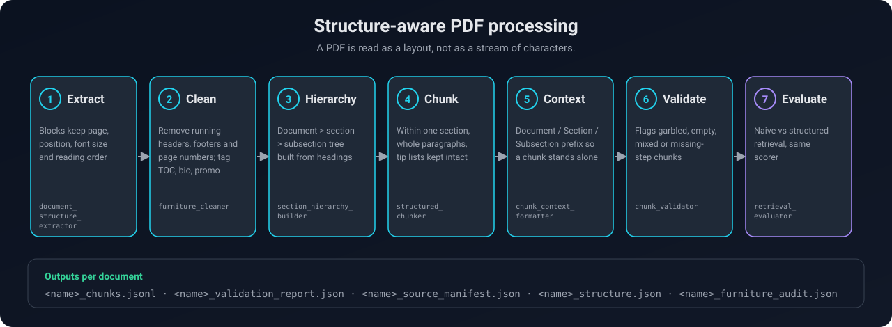
</p>

| Stage | Module (`backup_cleanup/python_files/`) | What it does |
|-------|------------------------------------------|--------------|
| **1. Extract** | `document_structure_extractor.py` | Reads PDFs with PyMuPDF and keeps every block's page, coordinates, font size, boldness and reading order. Classifies headings by font size and weight. Detects garbled text (broken spacing, encoding junk) and retries the page with alternate layout settings or OCR. It never "fixes" words with an LLM. |
| **2. Clean** | `furniture_cleaner.py` | Removes repeated running headers/footers and standalone page numbers using page position plus repetition across pages. Tags table-of-contents, author-bio and promotional blocks so they can be kept out of training text. Every removal is written to an audit log; nothing disappears silently. |
| **3. Hierarchy** | `section_hierarchy_builder.py` | Builds a document -> section -> subsection tree from headings (`Chapter N`, `Step N`, `Part N`, `Module N`, Markdown `##`, and font-based headings). The title comes from a real title page, or from the filename when the PDF has none. |
| **4. Chunk** | `structured_chunker.py` | Chunks inside a section, never across sections. Splits on paragraph, then sentence boundaries. Keeps numbered lists and labelled tips together. Counts real tokens with `tiktoken` (default target 500, maximum 800 including context). |
| **5. Context** | `chunk_context_formatter.py` | Gives every chunk an `embedding_text` with a `Document:` / `Section:` / `Subsection:` prefix so it stands alone at retrieval time. Exports JSONL with page range, source block IDs and quality flags. |
| **6. Validate** | `chunk_validator.py` | Before embedding, flags empty bodies, garbled text, detached headings, chunks that mix unrelated sections, and missing numbered steps/chapters/parts/modules. Builds a manifest recording whether every source block was included, excluded or held for review. Re-importing a document replaces its old chunks instead of duplicating them. |
| **7. Evaluate** | `retrieval_evaluator.py` | Benchmarks retrieval on naive vs. structure-aware chunks with the same scorer, on a built-in sample or your own file. |
| *Glue* | `structured_pipeline.py` | One function that runs stages 1-6 and writes the artifacts; used by the orchestrator and the benchmark. |

### A chunk, concretely

Each line of `<name>_chunks.jsonl` is one chunk:

| Field | Meaning |
|-------|---------|
| `chunk_id` | Stable identifier |
| `section_path` | `Document > Section > Subsection` |
| `embedding_text` | Breadcrumb prefix + body: what you embed |
| `source_text` | The body alone: what you quote |
| `token_count` | Real `tiktoken` count |
| `page_start`, `page_end` | Where it came from |
| `quality_flags` | Any validator findings |
| `source_block_ids` | Exact source blocks, for traceability |

### Run it

```bash
cd backup_cleanup/python_files

# Chunk one document (PDF, TXT or MD)
python pipeline_cli.py chunk-structured path/to/document.pdf

# Tune chunk size (tokens)
python pipeline_cli.py chunk-structured path/to/document.pdf --target-tokens 400 --max-tokens 700

# Benchmark structure-aware vs. naive chunking on YOUR document
python pipeline_cli.py evaluate-retrieval --file path/to/document.pdf

# ...or on the built-in synthetic document (quick smoke test)
python pipeline_cli.py evaluate-retrieval
python pipeline_cli.py evaluate-retrieval --output-report my_report.json
```

`chunk-structured` writes to `Phase 2/<document name>/` (override with `--output-dir`):

| File | Contents |
|------|----------|
| `<name>_chunks.jsonl` | The chunks (fields above) |
| `<name>_validation_report.json` | Every issue found, with severity (`error` / `warning`) and sample text. Includes a completeness check: every numbered unit the document evidences (headings like `Chapter 4`, or a count promised by the title such as "Ten Step ...") must appear in the chunks, and gaps in the source's own numbering are flagged |
| `<name>_source_manifest.json` | The fate of every source block: included, excluded (with reason) or held for review |

### Where it runs automatically

- **`start` / `process` CLI commands:** the workflow orchestrator has a `structured_chunking` stage that runs on every PDF, TXT and MD file, writing `output/<name>/<name>_chunks.jsonl`, `_validation_report.json` and `_source_manifest.json` beside the existing text/AI stages. CSV and JSON skip it. A failure in this stage is logged and counted but never discards the rest of the workflow's output.
- **Phase Control / GUI:** Phase 1 saves `_structure.json` and `_furniture_audit.json`; Phase 2 consumes them to produce the chunk files. If any structured-pipeline module fails to import, Phase 2 falls back to the original sentence-based chunker and logs a warning. If structured PDF extraction fails, Phase 1 falls back to PyMuPDF text, then PyPDF2, then pdfplumber.

### Benchmark

<p align="center">
  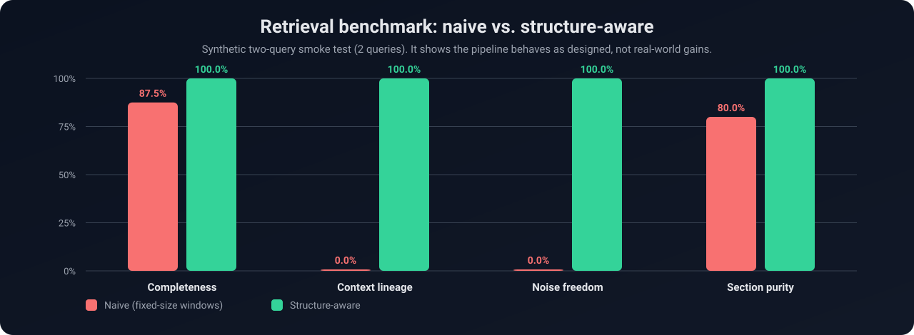
</p>

The numbers above come from `retrieval_comparison_report.json` in the repository root. **This is a synthetic smoke test: two queries against a small generated document.** It shows the pipeline behaves as designed (no header/footer noise, intact tip lists, breadcrumbs present). It is **not** evidence of a particular improvement on your data. Run `evaluate-retrieval --file your.pdf` for a measurement on a real document.

With `--file`, the benchmark derives queries from the document's own sections (each asks what a section covers; the expected facts are the terms most distinctive to that section), builds a fixed-size-character baseline from the same extracted text, and measures noise against the headers/footers actually removed from *your* file. A metric that gets worse is reported as "regressed", not glossed over.

---

## Output formats

Ten conversation formats are implemented in `format_templates.py` (`ConversationFormat`):

| Format | Typical target | Shape |
|--------|----------------|-------|
| `qwen` | Qwen models | `<\|user\|>prompt<\|assistant\|>response` |
| `alpaca` | Alpaca-style instruction tuning | `### Instruction` / `### Response` blocks |
| `chatml` | ChatML-based models | `<\|im_start\|>user ... <\|im_end\|>` |
| `sharegpt` | ShareGPT datasets | `{"conversations": [...]}` |
| `llama2` | Llama 2 | `[INST] prompt [/INST] response` |
| `zephyr` | Zephyr-style chat templates | role-tagged chat template |
| `instruct` | Generic instruction format | instruction / response pair |
| `openai` | ChatGPT fine-tuning | `{"messages":[{"role":"user",...},{"role":"assistant",...}]}` |
| `claude` | Claude-style human/assistant turns | role-tagged turns |
| `minimalist` | Lightweight prompt/response | plain pair |

For **ChatGPT fine-tuning**, choose **GPT JSONL** in the Processing tab (or set the Phase 3 target to `openai`/`gpt_jsonl`). Phase 3 then writes one file per document plus a combined `chatgpt_training.jsonl`.

---

## Security and sanitization

Phase 1 treats every input as untrusted. The Security tab controls three levels (**Strict**, **Balanced** (recommended), **Permissive**) and these checks:

| Check | What it catches |
|-------|-----------------|
| **Unicode normalization** | Inconsistent encodings, compatibility characters |
| **Invisible character removal** | Zero-width and control characters that hide content |
| **RTL/LTR override detection** | Bidirectional-control tricks that make text read differently from how it is stored |
| **Entropy analysis** | Blocks that look encrypted, encoded or otherwise hidden |
| **Homoglyph detection** | Lookalike characters from other scripts used to disguise words |
| **Malformed markup validation** | Broken or hostile HTML/XML-style markup |

Suspicious files are routed to a quarantine store (`quarantine_system.py`) instead of silently continuing, and every event appears in the **Security Logs** pane. Relevant modules: `sanitization_engine.py`, `quarantine_system.py`, `security_config.py`.

> Sanitization reduces risk in training data; it is not a malware scanner for the files themselves. Open untrusted documents with care.

---

## Personalities

Phase 3 can rewrite training examples in a consistent voice (`personality_modifier.py`).

| Profile | Voice |
|---------|-------|
| Neutral | No transformation |
| Professional | Formal, business-appropriate |
| Casual | Conversational, relaxed |
| Technical | Precise, technical language |
| Creative | Imaginative, varied |
| Friendly | Warm, approachable |
| Formal | Traditional, respectful |
| Humorous | Light, witty |
| Educational | Clear, instructive |
| Conversational | Natural dialogue |

**Strength** runs from 0.1 (subtle) to 1.0 (strong). **Custom personalities** let you describe a style in your own words, preview it, and save it. Saved ones are stored in `custom_personalities.json` (git-ignored, because it is user data). See [`docs/CUSTOM_PERSONALITIES_README.md`](docs/CUSTOM_PERSONALITIES_README.md).

Personality rewriting uses your configured AI provider, so it incurs cost on cloud models and is free on local ones.

---

## AI providers and cost control

| Provider | Needs a key | Cost | Typical model |
|----------|-------------|------|---------------|
| **OpenAI** | Yes | Paid | `gpt-4o` |
| **OpenRouter** | Yes | Paid | `openrouter/auto` |
| **Ollama** | No | Free (local) | `qwen2.5:7b` |
| **LM Studio** | No | Free (local) | `local-model` |

```bash
# OpenAI
export OPENAI_PROVIDER=openai
export OPENAI_API_KEY="your-key-here"
export OPENAI_MODEL="gpt-4o"

# OpenRouter (many models, one key)
export OPENAI_PROVIDER=openrouter
export OPENROUTER_API_KEY="your-key-here"
export OPENROUTER_BASE_URL="https://openrouter.ai/api/v1"
export OPENAI_MODEL="openrouter/auto"

# Ollama (local, no key)
export OPENAI_PROVIDER=ollama
export OLLAMA_BASE_URL="http://127.0.0.1:11434/v1"
export OPENAI_MODEL="qwen2.5:7b"

# LM Studio (local, no key)
export OPENAI_PROVIDER=lmstudio
export LMSTUDIO_BASE_URL="http://127.0.0.1:1234/v1"
export OPENAI_MODEL="local-model"
```

**Cost controls.** A **Daily Cost Limit** caps spend (the GUI default is $20; set it to $0 for local models), **Cost Tracking** logs every call, and **Free Cost Mode** applies the Ollama preset in one click. Phase 4 is the largest AI consumer, so toggle it off while experimenting.

**Key hygiene.** Use environment variables only, never put real keys in tracked files, and rotate a key immediately if it is exposed.

---

## The Ten Pillars quality system

An optional layer of data-quality machinery (`ten_pillars_integration.py`, `data_contract.py`, and related modules) with its own GUI tab. Its pillars include a data contract (immutable schema), multi-layer filtering (pre-ingestion, semantic, deduplication, policy), disciplined prompting, uniform formatting, and iterative quality scoring with a minimum threshold.

What is and is not there:

- **Pillars 1-6 and 8 have working code** (7 of 10). Pillars 7 (continuous governance), 9 (post-fine-tune feedback) and 10 (cultural reinforcement) have no code; 10 is a practice, not software. The app reports "7 of 10" and the compliance report marks those three `not_implemented`.
- The 95% accuracy figure is a configured **target**, not a verified result. Per-metric scores (factuality, fluency and so on) show "not measured" until items are scored.
- Use the validation reports and the retrieval benchmark for evidence about your outputs.

---

## Command-line reference

All commands run from `backup_cleanup/python_files` via `python pipeline_cli.py <command>`.

| Command | Purpose | Key options |
|---------|---------|-------------|
| `start` | Run the full pipeline with file monitoring | `--no-monitor`, `--process-existing`, `--daemon` |
| `process` | Process a folder once and exit | `--folder` (default `input`), `--parallel`, `--report FILE` |
| `process-file FILE` | Process a single file | `--stage {extract,filter,enhance,all}`, `--output` |
| `monitor` | Watch a folder only | `--folder`, `--interval` (seconds, default 2.0) |
| `status` | Show pipeline status | `--detailed`, `--json` |
| `config` | Manage configuration | `--create-env`, `--validate`, `--show`, `--test-openai` |
| `cleanup` | Tidy folders | `--archive-old`, `--clear-cache`, `--clear-logs`, `--days N` (default 30) |
| `stats` | Processing statistics | `--period {today,week,month}`, `--export FILE` |
| `chunk-structured FILE` | Structure-aware chunking | `--output-dir`, `--target-tokens`, `--max-tokens` |
| `evaluate-retrieval` | Naive vs. structured benchmark | `--file`, `--output-report` |

Launcher scripts:

| Script | Purpose |
|--------|---------|
| `./go_live.sh` | Runs the strict health check, then launches the app. `--check-only` stops after the check |
| `./run_pipeline.sh` | General launcher: `--setup full`, `--health-only`, `--smoke`, `--strict` |
| `run_pipeline.bat` | Windows launcher |

Typical health checks:

```bash
./run_pipeline.sh --health-only --smoke            # folders, dependencies, synthetic smoke flow
./run_pipeline.sh --health-only --smoke --strict   # also fails if credentials/dependencies are missing
```

If the strict check fails: verify provider environment variables and real keys (credentials), run `python3 setup.py --install-type full --yes` (dependencies), or confirm Ollama/LM Studio is running and reachable (local provider).

---

## Configuration reference

**Structured chunking** (orchestrator stage):

| Environment variable | Default | Description |
|----------------------|---------|-------------|
| `ENABLE_STRUCTURED_CHUNKING` | `true` | Turn the stage on/off |
| `STRUCTURED_TARGET_TOKENS` | `500` | Preferred chunk size |
| `STRUCTURED_MAX_TOKENS` | `800` | Hard ceiling, including the context prefix |

**Providers:** `OPENAI_PROVIDER`, `OPENAI_API_KEY`, `OPENAI_MODEL`, `OPENROUTER_API_KEY`, `OPENROUTER_BASE_URL`, `OLLAMA_BASE_URL`, `LMSTUDIO_BASE_URL` (see [AI providers](#ai-providers-and-cost-control)).

**Files:**

| File | Purpose |
|------|---------|
| `config/pipeline_phases.json` | Phase toggles and per-phase settings (rewritten by the GUI) |
| `custom_personalities.json` | Your saved personalities (git-ignored) |
| `ios_remote/.token` | The iOS remote's private access token (owner-only; never commit) |

---

## iPhone / iPad remote

<p align="center">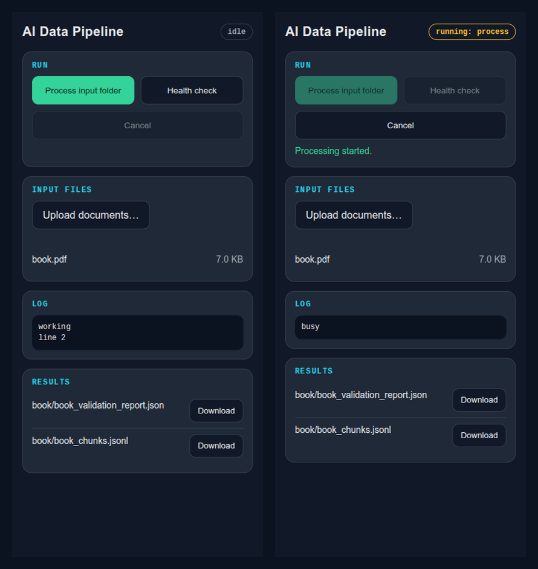</p>

A small web app served by the computer that runs the pipeline. Add it to your Home Screen and it behaves like a native app: upload documents, start a run, watch the log, download results.

```bash
cd backup_cleanup/python_files
python3 install_app.py --only ios        # one-time: creates your private access token
launchers/ios/start_ios_remote.sh        # Windows: launchers\ios\start_ios_remote.bat
```

It prints a link and a QR code. Scan with the iPhone camera, open in **Safari**, then **Share -> Add to Home Screen**.

**How it is protected**

- **Token required.** Every request needs a bearer token (compared in constant time); repeated failures from a client trigger a lockout.
- **Fixed commands only.** The server can run exactly two jobs: process the input folder, and run the health check. There is no shell access.
- **Safe uploads.** Limited by type (PDF/TXT/MD/CSV/JSON/JSONL) and size (100 MB). Uploads cannot overwrite existing files, escape the input folder, or create hidden files.
- **Encrypted path by default.** If Tailscale is present the server binds to the Tailscale address, so traffic is encrypted and works away from home. Otherwise it binds to `127.0.0.1`. For home Wi-Fi pass `--host <LAN IP>`; that is plain HTTP, so use a network you trust.
- **Never port-forward it to the internet.**

| Option | Effect |
|--------|--------|
| `--host ADDRESS` | Address to bind |
| `--port N` | Port (default `8765`) |
| `--show-url` | Print the access URL and QR, then exit |
| `--new-token` | Invalidate the old token and create a new one (signs out every installed icon) |

An optional start-at-login unit is provided at `backup_cleanup/python_files/launchers/ios/ai-data-pipeline-remote.service`; the full guide is `launchers/ios/INSTALL_IOS_APP.md`.

> **Tested vs. untested:** the server and its web UI are covered by automated tests and were exercised in a desktop browser with a phone-sized viewport. It has **not** been tried on a physical iPhone or iPad.

---

## Project layout and architecture

<p align="center">
  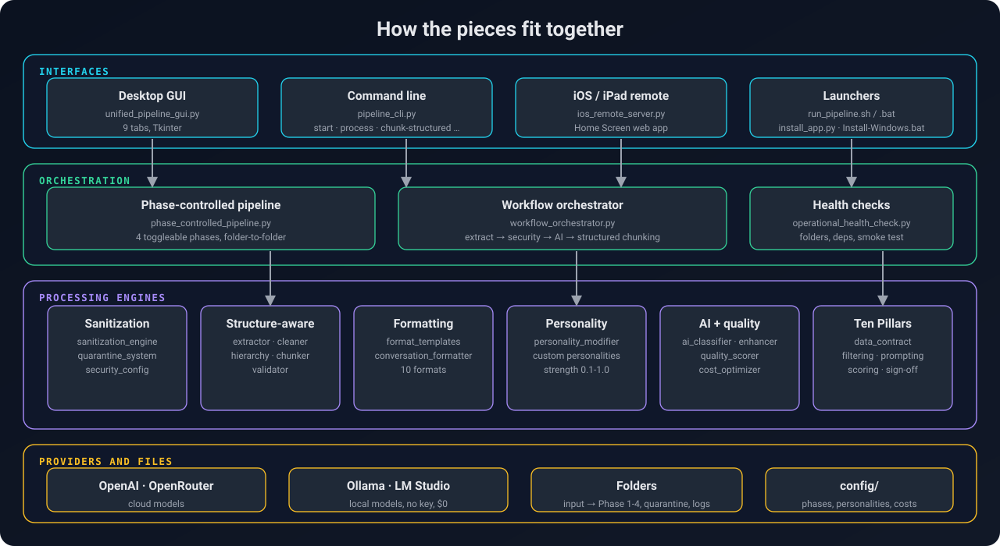
</p>

```
AI-DataTuner-master/
├── README.md                      this file
├── RUNBOOK.md                     operator guide
├── Install-Windows.bat            Windows one-click installer
├── config/                        phase toggles and settings
├── docs/                          extra guides and README images
├── input/  Phase 1/ ... Phase 4/  the folder chain
├── retrieval_comparison_report.json   synthetic benchmark output
├── backup_cleanup/
│   ├── python_files/              application code
│   │   ├── unified_pipeline_gui.py        desktop GUI (9 tabs)
│   │   ├── pipeline_cli.py                command line
│   │   ├── phase_controlled_pipeline.py   4 toggleable phases
│   │   ├── workflow_orchestrator.py       stage chain for start/process
│   │   ├── structured_pipeline.py + document_structure_extractor.py,
│   │   │   furniture_cleaner.py, section_hierarchy_builder.py,
│   │   │   structured_chunker.py, chunk_context_formatter.py,
│   │   │   chunk_validator.py, retrieval_evaluator.py
│   │   ├── sanitization_engine.py, quarantine_system.py, security_config.py
│   │   ├── format_templates.py, conversation_formatter.py, personality_modifier.py
│   │   ├── ten_pillars_integration.py, data_contract.py
│   │   ├── ios_remote_server.py + ios_remote/   iPhone/iPad web app
│   │   ├── install_app.py, install_windows.ps1, launchers/
│   │   └── go_live.sh, run_pipeline.sh/.bat, setup.py
│   └── test_files/                pytest suite
```

**How a run flows.** The GUI, CLI and iOS remote are only front ends. They hand work to either the phase-controlled pipeline (folder to folder, with toggles) or the workflow orchestrator (`extract -> security -> AI -> structured chunking`). Both call the same processing engines: sanitization, the structure-aware modules, formatting, personality, AI classification/quality scoring and the Ten Pillars layer, which talk to your chosen AI provider and read/write the phase folders and `config/`.

---

## Testing

```bash
cd backup_cleanup/python_files
venv/bin/python -m pytest ../test_files -q
```

The suite currently has **97 passing tests and 0 failing**. Coverage highlights:

| Test file | Covers |
|-----------|--------|
| `test_structured_extraction_pipeline.py` | Each stage: extraction, furniture cleaning, hierarchy (including title inference), chunking, context formatting, validation, retrieval benchmark |
| `test_pipeline_integration.py` | The wiring: completeness validation for any numbered document, `evaluate-retrieval --file`, the orchestrator's `structured_chunking` stage on a generated PDF |
| `test_installers.py` | Windows and Linux installers, including a PowerShell dry run |
| `test_ios_remote.py` | Auth, lockout, upload/download path safety, job control |
| `test_phase_settings_gui_path.py` | Saved Phase 2 settings (including the legacy 150-token migration) drive the structure-aware chunker; all ten Phase 3 formats render as themselves; Ten Pillars reporting is not overstated |

---

## Troubleshooting

| Problem | Solution |
|---------|----------|
| GUI won't start | Run `./go_live.sh` from a terminal to see the error |
| `No module named tkinter` | Install Tk (`sudo apt install python3-tk`; on Windows re-run the Python installer with **tcl/tk** selected) |
| API key not working | Check the environment variable, or enter the key in **AI Settings** and use **Test** |
| Local model won't connect | Start Ollama or LM Studio before the pipeline; confirm the endpoint URL |
| Out of memory | Lower **Parallel Workers** to 1-2 in the Processing tab |
| Files not processing | Input folder must contain PDF, CSV, JSON, JSONL, TXT or MD files |
| `ModuleNotFoundError: pymupdf` / `tiktoken` | `pip install -r requirements.txt` inside the project venv |
| "Structured pipeline import error" | A structured-pipeline module or dependency is missing; Phase 2 is using the basic chunker. Fix the import and re-run |
| "Structured PDF extraction failed, falling back" | The PDF could not be parsed with layout data (encrypted or corrupt?). Text is still extracted, but without headings or furniture removal |
| Validation report shows `garbled_text` | The PDF text layer is broken. Use an OCR'd copy, or install `pytesseract` + Tesseract so the page can be retried with OCR |
| Section paths look flat or wrong | Headings were not detected. Check `<name>_structure.json` for `is_heading` flags |
| iPhone can't reach the remote | Check both devices are on the same Tailscale/Wi-Fi network and that you used the printed URL; run `--show-url` again |

Where to look: the **Monitoring** tab for errors, **Security Logs** for sanitization events, and lower parallelism for cleaner error output.

---

## Known limitations

- Heading detection relies on font size/weight and the `Chapter/Step/Part/Module` patterns. PDFs whose headings match body text will give a flat hierarchy.
- The completeness check covers only numbered units (`Step`, `Chapter`, `Part`, `Module`, digits or words up to twenty). Documents with unnumbered headings get per-chunk checks but no "is anything missing?" check.
- `--file` benchmark queries come from section titles and vocabulary, so they favour topic-word retrieval. On documents with only a few chunks, completeness saturates at 100% for both systems; noise, context and purity are the informative metrics there.
- Scanned PDFs need the Tesseract binary plus `pytesseract` (now in `requirements.txt`); without them image-only pages yield no text.
- Pillars 7, 9 and 10 of the Ten Pillars system are not implemented (see [above](#the-ten-pillars-quality-system)).
- The Windows installer and the iOS remote have not been run on real Windows or iOS hardware.

---

## More documentation

| Document | What's in it |
|----------|--------------|
| [`RUNBOOK.md`](RUNBOOK.md) | Day-to-day operator guide ([gist copy](https://gist.github.com/IceMasterT/281c0f2e008d25d21d3798b07fefb0f9)) |
| [`docs/AI_INTEGRATION_README.md`](docs/AI_INTEGRATION_README.md) | AI provider integration |
| [`docs/CUSTOM_PERSONALITIES_README.md`](docs/CUSTOM_PERSONALITIES_README.md) | Writing custom personalities |
| [`backup_cleanup/python_files/launchers/ios/INSTALL_IOS_APP.md`](backup_cleanup/python_files/launchers/ios/INSTALL_IOS_APP.md) | iOS remote install guide |
| [`COMMUNITY.md`](COMMUNITY.md) | Discussions and support |

---

## License

MIT License with Commons Clause. Copyright (c) 2024. See [`LICENSE`](LICENSE).

Built with Python, Tkinter, PyMuPDF, tiktoken, the OpenAI SDK, and contributions from the open-source community.
